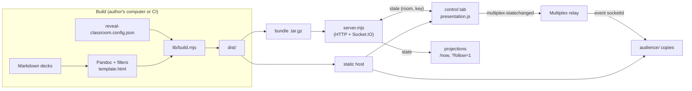

# Architecture

## Components

| Piece | File | Runs in |
|---|---|---|
| CLI | `bin/reveal-classroom.mjs` | Node |
| Build | `lib/build.mjs` | Node + Pandoc |
| Bundle | `lib/bundle.mjs` | Node + tar |
| Server | `server.mjs` (single file, depends on `socket.io` only) | Node |
| Deck client | `client/presentation.js` | browser, every deck |
| Launcher | `client/launcher.html` (template) + `client/launcher.js` | browser |
| Relay protocol | `client/relay-protocol.js` (classic script; imported by tests) | browser, Node tests |
| Phone controller and status styles | `client/reveal-classroom.css` | browser |
| Default theme and template | `client/theme.css`, `client/template.html` | browser, Pandoc |
| Interface strings | `i18n/en.json`, `i18n/ro.json` | build → `site.js`/`site.json` |
| Deploy kit | `deploy/` | server |

## Build output

The build writes `site.js` (`window.REVEAL_CLASSROOM = { title, language, strings, relay, launcher,
reveal, slideBackgrounds, fitText }`) for the browser and the same data as `site.json` for the
server. Decks reference shared files with relative URLs (`../presentation.js`), so the same
`dist/` works at any URL prefix, on a server or a static host. `decks/` holds the presenter
copies; `audience/` the same decks with `<aside class="notes">` removed.

## Roles of a deck page

`presentation.js` decides the role from the URL:

| URL | Role |
|---|---|
| `decks/X.html` | standalone presentation (speaker view with **S**) |
| `decks/X.html?room=R` | controller of server session R (key from `sessionStorage['rc-room-R']`) |
| `decks/X.html?room=R&follow=1` | follower of server session R (what `/now` redirects to) |
| `decks/X.html?id=S[&relay=U]` | controller of relay session S (secret from `sessionStorage['rc-relay-S']`) |
| `audience/X.html?id=S&follow=1[&relay=U]` | follower of relay session S |
| `…?receiver` | speaker-view preview frames: never open sockets |

Followers have no keyboard, touch, controls, overview or notes plugin; the phone controller
replaces the controls when a controller page is on a touch screen or narrower than 600 px.

## Server protocol

- `POST /api/sessions` with `Authorization: Bearer <password>` and `{"deck": "X.html"}` →
  `201 {"room", "key"}`. The deck must be listed in `decks.json`. Rate limit: 20 attempts per
  minute per address; at most 1000 sessions.
- `GET /now` → `302` to `decks/X.html?room=R&follow=1` for the latest session, or a waiting page
  that refreshes every 5 seconds. The key is never in this URL.
- Socket.IO at `BASE_PATH/socket.io`, handshake `auth: { room, key, follower, deck }`. The server
  rejects unknown or expired rooms, a deck that differs from the session's, and controllers
  without the right key. A controller emits `state`; the server validates it (`indexh`, `indexv`
  integers in range, `indexf` ≥ −1, `paused` boolean, overview forced off), stores it, and
  forwards it to the room. A follower receives the stored state when it connects.
- `GET /health` → `{"ok": true}`.
- Static files: an explicit allow-list (`index.html`, `site.js`, `decks.json`, the client files,
  `theme.css`), decks listed in `decks.json` under `decks/` and `audience/`, and `vendor/reveal/`.
  `site.json` is read by the server, not served. Responses carry `Cache-Control: no-store`,
  `X-Content-Type-Options: nosniff` and `Referrer-Policy: no-referrer`. For `decks/…?follow=1`
  the server removes the notes from the HTML.

## Relay protocol

See [relay.md](relay.md#what-happens). The message format and validation live in
`client/relay-protocol.js`, shared with `test/relay.test.mjs`.

## Security model

- **Password**: protects session creation only. Compared in constant time.
- **Control key**: 24 random bytes per session, held by the creating tab (`sessionStorage`), sent
  in the Socket.IO handshake, never placed in a URL. Without it a socket can only follow.
- **Followers**: receive slide coordinates and the pause flag; their input is ignored.
- **Notes**: stripped from follower responses by the server; absent from `audience/` copies.
  Presenter copies (`decks/`) contain notes; on a static host they are public.
- **State**: in memory only. A restart ends every session; nothing is persisted or logged.
- **Relay**: the operator sees positions, the session id and the secret (needed to check the
  hash). Anyone with the id can follow.
- **Update path**: servers pull public release assets over HTTPS, verify a SHA-256 checksum and
  the recorded revision, and refuse archives with unexpected entries before installing.

## Bundle contract

Deploy bundles must keep the top-level entries `dist/`, `deploy/`, `server.mjs`, `package.json`
and `package-lock.json`, with `server.mjs` runnable as `node server.mjs` after
`npm ci --omit=dev`. Installed update scripts (including older versions, such as the AMSS
example's `receive-ci.sh`) validate this layout *before* they run the new bundle's installer;
changing it would strand existing installations. Add files inside `dist/` or `deploy/` instead.
